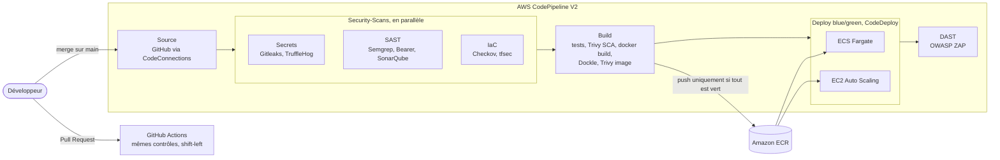

# Pipeline CI/CD DevSecOps sur AWS CodePipeline


Conception et déploiement d'un pipeline CI/CD sécurisé sur AWS, entièrement décrit en Terraform :

- **CodePipeline** (V2) orchestre la chaîne, de GitHub jusqu'à la production ;
- **CodeBuild** exécute les tests, la compilation de l'image Docker et tous les scans de sécurité ;
- **CodeDeploy** réalise des déploiements **blue/green** sur **ECS Fargate** et sur une flotte **EC2 Auto Scaling**, avec rollback automatique ;
- **GitHub Actions** rejoue les mêmes contrôles sur chaque Pull Request (*shift-left*).

Une release n'atteint la production que si **10 outils de sécurité** l'ont validée : secrets (Gitleaks, TruffleHog), SAST (Semgrep, Bearer, SonarQube), IaC (Checkov, tfsec), SCA (Trivy), image (Dockle, Trivy) et DAST (OWASP ZAP).

---

## Architecture



| # | Étape | Service | Contenu | Bloque si |
|---|-------|---------|---------|-----------|
| 1 | **Source** | CodePipeline + CodeConnections | Clone Git complet de `main` (historique inclus) | — |
| 2 | **Security-Scans** | 3 projets CodeBuild en parallèle | Secrets, SAST, IaC | un secret, un finding critique/haut ou une Quality Gate en échec |
| 3 | **Build** | CodeBuild (Docker) | Tests + couverture, SCA, build, scan d'image, push ECR, artefacts CodeDeploy | test KO, CVE HIGH/CRITICAL corrigeable, image non conforme |
| 4 | *Approval* (optionnel) | CodePipeline | Validation manuelle avant production | refus |
| 5 | **Deploy-BlueGreen** | CodeDeploy | ECS Fargate et EC2 en parallèle | health checks KO, alarme 5xx → **rollback automatique** |
| 6 | **DAST** | CodeBuild + OWASP ZAP | Vérifie la version servie puis scanne les 2 environnements | alerte ZAP classée `FAIL` |

## Contrôles de sécurité

| Catégorie | Outil | Ce qui est analysé | Critère bloquant |
|-----------|-------|--------------------|------------------|
| Secrets | **Gitleaks** | Tout l'historique Git | tout secret détecté (`.gitleaks.toml`) |
| Secrets | **TruffleHog** | Tout l'historique Git, secrets **vérifiés** auprès des fournisseurs | secret vérifié ou non vérifiable |
| SAST | **Semgrep** | Code Node.js / Express, Dockerfile (règles OWASP Top 10) | finding de sévérité `ERROR` ou `WARNING` |
| SAST | **Bearer** | Flux de données sensibles, sécurité applicative | finding `critical` ou `high` |
| SAST | **SonarQube** *(optionnel)* | Qualité, bugs, vulnérabilités, couverture | Quality Gate en échec |
| IaC | **Checkov** | Terraform, Dockerfile, workflows GitHub Actions | toute règle non justifiée dans `.checkov.yaml` |
| IaC | **tfsec** | Terraform | finding `HIGH` ou `CRITICAL` non justifié |
| SCA | **Trivy** (`fs`) | Dépendances npm (`package-lock.json`) | CVE HIGH/CRITICAL avec correctif disponible |
| Image | **Dockle** | Bonnes pratiques CIS Docker de l'image finale | niveau `WARN` ou plus |
| Image | **Trivy** (`image`) | Paquets OS + librairies de l'image | CVE HIGH/CRITICAL avec correctif disponible |
| DAST | **OWASP ZAP** | Application déployée (ECS et EC2) | règle passée en `FAIL` dans `.zap/rules.tsv` |

Chaque outil produit un rapport (SARIF, JSON ou HTML) archivé dans S3 :
`s3://<bucket-artefacts>/security-reports/<id-execution>/<etape>/`. Les résultats des tests unitaires et la couverture apparaissent aussi dans l'onglet **Reports** de CodeBuild.

Toutes les exceptions sont **explicites et justifiées** dans le code (`.checkov.yaml`, commentaires `#tfsec:ignore`, `.trivyignore`, `.zap/rules.tsv`).

## Déploiements blue/green

**ECS Fargate** : le service utilise le contrôleur de déploiement `CODE_DEPLOY`. À chaque release, CodeDeploy démarre un nouveau *task set* (green) derrière un second target group, l'expose d'abord sur le listener de test (port 8080), puis bascule le listener de production (port 80). Le *task set* blue est conservé `blue_termination_wait_minutes` minutes pour permettre un retour arrière instantané. La stratégie est configurable : `AllAtOnce`, `Canary10Percent5Minutes`, `Linear10PercentEvery1Minutes`.

**EC2** : CodeDeploy copie l'Auto Scaling Group, installe la nouvelle révision sur les instances green (hooks `pull_image.sh` → `start_container.sh` → `validate_service.sh`), les enregistre dans l'ALB, puis termine les instances blue.

**Rollback automatique** dans les deux cas si le déploiement échoue ou si l'alarme CloudWatch `HTTPCode_Target_5XX_Count` se déclenche.

## Sécurité de la plateforme elle-même

- **Chaîne d'approvisionnement** : chaque outil est épinglé à une version **et** à une empreinte SHA-256 (`scripts/tool-versions.env`) ; tags d'image ECR **immuables** (1 tag = 1 commit) ; image poussée **uniquement** après tous les scans.
- **Chiffrement** : une clé KMS gérée par le client (rotation automatique) chiffre les artefacts S3, les images ECR, les logs CloudWatch et les builds CodeBuild ; le bucket refuse tout accès non-TLS.
- **IAM au moindre privilège** : un rôle par service, ressources ciblées par ARN, `iam:PassRole` restreint par `iam:PassedToService`, rôle de tâche ECS sans aucune permission.
- **Réseau** : ECS et EC2 dans des sous-réseaux privés, entrée uniquement depuis l'ALB, sortie limitée au HTTPS, security group par défaut fermé, VPC Flow Logs.
- **Calcul durci** : IMDSv2 obligatoire avec *hop limit* 1, volumes EBS chiffrés, pas de SSH (accès via SSM Session Manager).
- **Conteneur durci** : utilisateur non-root, système de fichiers en lecture seule, toutes les *capabilities* supprimées, `no-new-privileges`, npm/yarn retirés de l'image finale, `HEALTHCHECK`.
- **Application** : en-têtes de sécurité stricts (CSP, Permissions-Policy, COEP/COOP/CORP, X-Content-Type-Options…), contrôlés par les tests unitaires et par ZAP.
- **Un seul jeu de scripts** (`scripts/`) exécuté à l'identique en local, dans GitHub Actions et dans CodeBuild : pas de dérive entre la CI de PR et le pipeline de production.

## Structure du dépôt

```text
.
├── app/                          # Application Node.js (Express) + Dockerfile durci
│   ├── src/  public/  tests/
│   └── Dockerfile
├── buildspecs/                   # Une buildspec CodeBuild par étape du pipeline
│   ├── secrets.yml  sast.yml  iac.yml  build.yml  dast.yml
├── deploy/
│   ├── ecs/                      # taskdef.json + appspec.yaml (CodeDeployToECS)
│   └── ec2/                      # appspec.yml + hooks CodeDeploy
├── infra/terraform/              # VPC, KMS, S3, ECR, ALB, ECS, EC2/ASG, IAM,
│                                 # CodeBuild, CodeDeploy, CodePipeline
├── scripts/                      # Installation des outils + scans (partagés CI/CD/local)
├── .github/workflows/            # CI GitHub Actions sur les Pull Requests
├── .checkov.yaml  .gitleaks.toml  .semgrepignore  .trivyignore
├── .zap/rules.tsv                # Politique DAST (alertes bloquantes)
└── sonar-project.properties
```

## Déployer le projet

### Prérequis

- Un compte AWS et l'AWS CLI configurée (`aws sts get-caller-identity`)
- Terraform ≥ 1.6
- Ce dépôt publié sur votre compte GitHub

### 1. Créer l'infrastructure et le pipeline

```bash
cd infra/terraform
cp terraform.tfvars.example terraform.tfvars   # renseigner github_repository = "compte/depot"
terraform init
terraform apply
```

Environ 10 minutes. En attendant le premier passage du pipeline, le service ECS sert une page provisoire.

### 2. Activer la connexion GitHub (une seule fois)

La connexion CodeConnections est créée à l'état `PENDING`. Ouvrez l'URL de l'output `github_connection_url`, sélectionnez la connexion, puis **Update pending connection** et autorisez l'application *AWS Connector for GitHub* sur le dépôt.

### 3. Lancer le pipeline

Dans CodePipeline, cliquez sur **Release change** (ou poussez un commit sur `main`). Le premier passage dure environ 20 minutes. Ouvrez ensuite `ecs_app_url` et `ec2_app_url` : la page affiche le commit déployé et la cible (ECS ou EC2).

```bash
terraform output
```

### 4. (Optionnel) Activer SonarQube / SonarCloud

```bash
aws secretsmanager create-secret --name sonar-token --secret-string "<token-sonar>"
```

Puis renseignez `sonar_host_url`, `sonar_organization`, `sonar_project_key` et `sonar_token_secret_arn` dans `terraform.tfvars` et relancez `terraform apply`. Côté GitHub Actions : variables de dépôt `SONAR_HOST_URL`, `SONAR_ORGANIZATION`, `SONAR_PROJECT_KEY` et secret `SONAR_TOKEN`. Sans configuration, l'analyse Sonar est simplement ignorée.

### Démontrer un contrôle bloquant

Pour voir le pipeline refuser une release, ouvrez une Pull Request qui, au choix :

- committe un faux jeton GitHub (`ghp_…`) dans un fichier → **Gitleaks** échoue ;
- ajoute `res.send('<h1>' + req.query.name + '</h1>')` dans une route → **Semgrep** bloque une XSS ;
- passe `http_tokens = "optional"` dans `ec2.tf` → **Checkov** et **tfsec** échouent ;
- retire `USER node` du Dockerfile → **Dockle** échoue ;
- supprime `helmet()` dans `app.js` → les tests puis **OWASP ZAP** échouent.

## Exécuter en local

```bash
# Application
cd app && npm ci && npm test && npm start          # http://localhost:8080

# Image Docker
docker build -t devsecops-app app
docker run --rm -p 8080:8080 --read-only --cap-drop ALL devsecops-app
```

Les scans tournent sous Linux, macOS ou WSL avec Docker :

```bash
bash scripts/install-tools.sh gitleaks trufflehog semgrep bearer checkov tfsec trivy dockle
bash scripts/scan-secrets.sh
bash scripts/scan-sast.sh
bash scripts/scan-iac.sh
bash scripts/scan-sca.sh
bash scripts/scan-image.sh devsecops-app
ZAP_DOCKER_NETWORK=host bash scripts/scan-dast.sh http://localhost:8080
```

Les rapports sont écrits dans `reports/`.

## Coûts et nettoyage

Laissée en marche 24h/24, la démo coûte **environ 3 $ par jour** (NAT Gateway, 2 ALB, 1 tâche Fargate, 1 instance t3.micro). Une exécution du pipeline coûte quelques centimes de CodeBuild. Pensez à tout détruire après la démo :

```bash
# 1. Supprimer l'Auto Scaling Group créé par CodeDeploy (hors état Terraform)
aws autoscaling describe-auto-scaling-groups \
  --query "AutoScalingGroups[?starts_with(AutoScalingGroupName, 'CodeDeploy_')].AutoScalingGroupName" \
  --output text
aws autoscaling delete-auto-scaling-group --auto-scaling-group-name <nom> --force-delete

# 2. Détruire l'infrastructure
cd infra/terraform && terraform destroy
```

## Limites connues et pistes d'amélioration

- **HTTP uniquement** : la démo n'a pas de nom de domaine. En production : certificat ACM, listener HTTPS, redirection HTTP→HTTPS et HSTS (ces règles sont explicitement exclues des scans, avec justification).
- **Blue/green EC2 et Terraform** : CodeDeploy remplace l'Auto Scaling Group à chaque déploiement, l'ASG d'origine disparaît donc après la première release et un `terraform apply` ultérieur le recréerait. C'est un compromis connu : en production, on gère l'ASG hors Terraform après l'amorçage, ou on choisit un déploiement *in-place* pour EC2.
- **Hors périmètre pour limiter les coûts** : AWS WAF, logs d'accès ALB/S3, NAT Gateway par AZ, endpoints VPC d'interface pour ECR/Logs.
- **Pistes** : signature d'image (Cosign / AWS Signer), SBOM publié avec chaque release, tests de charge pendant le canary, notifications Slack/SNS des échecs, upload SARIF vers GitHub Code Scanning, backend Terraform distant dans S3.
